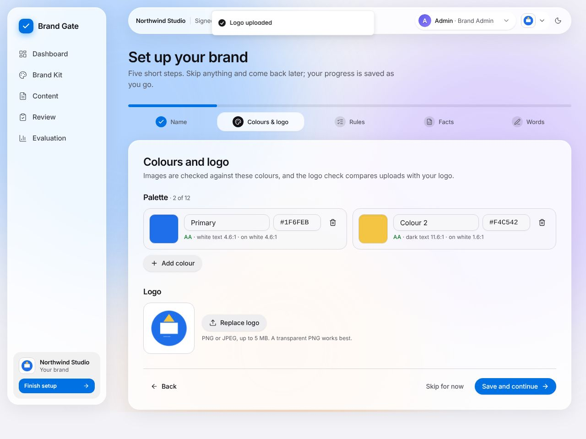
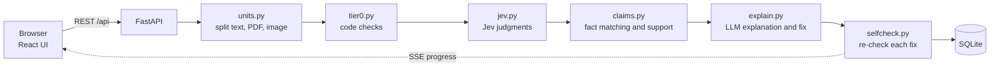
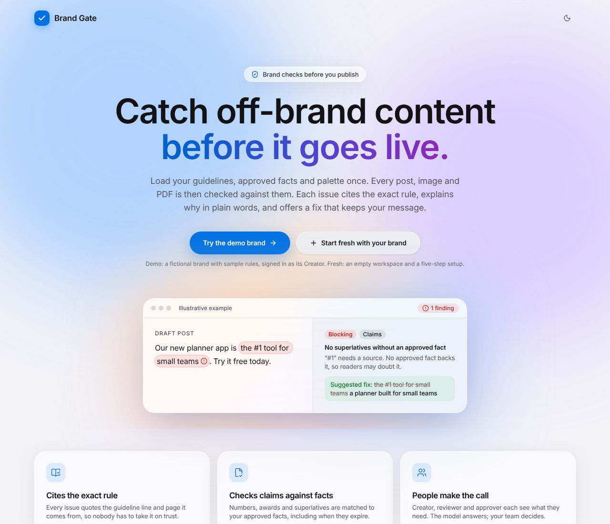
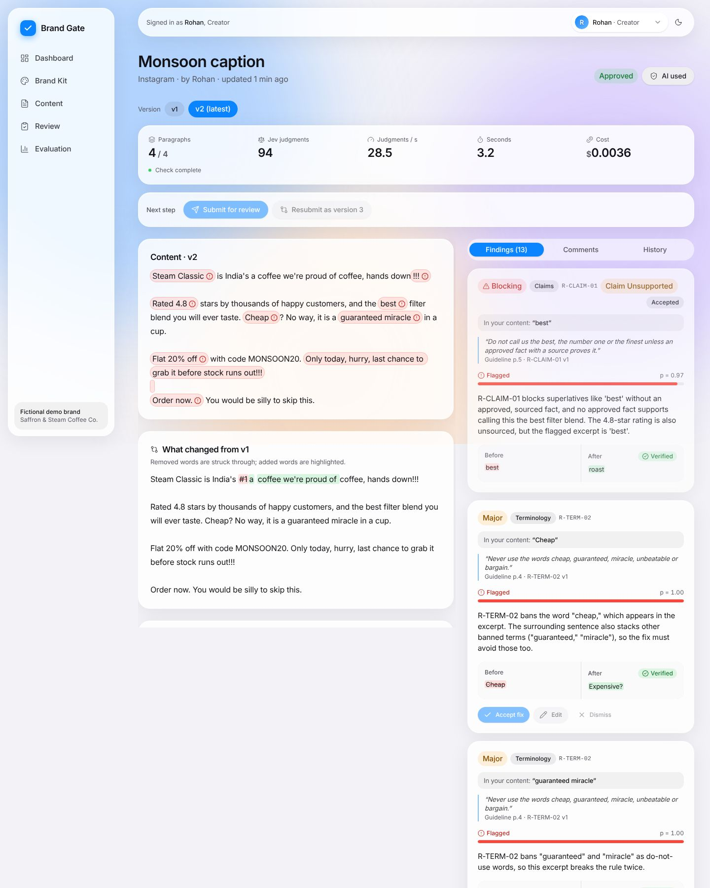
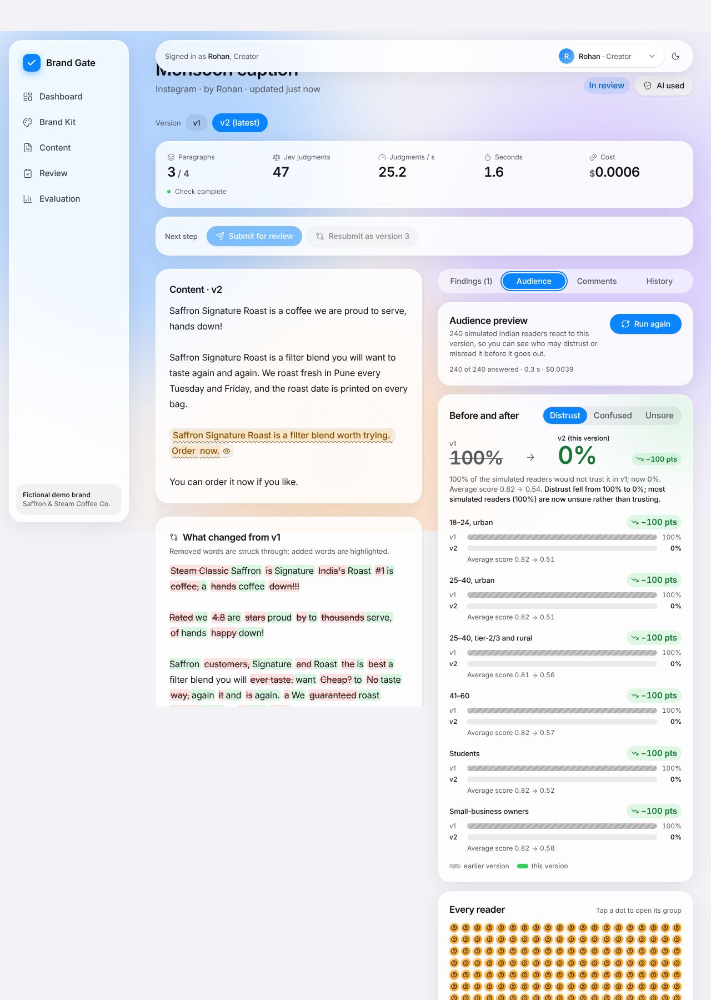
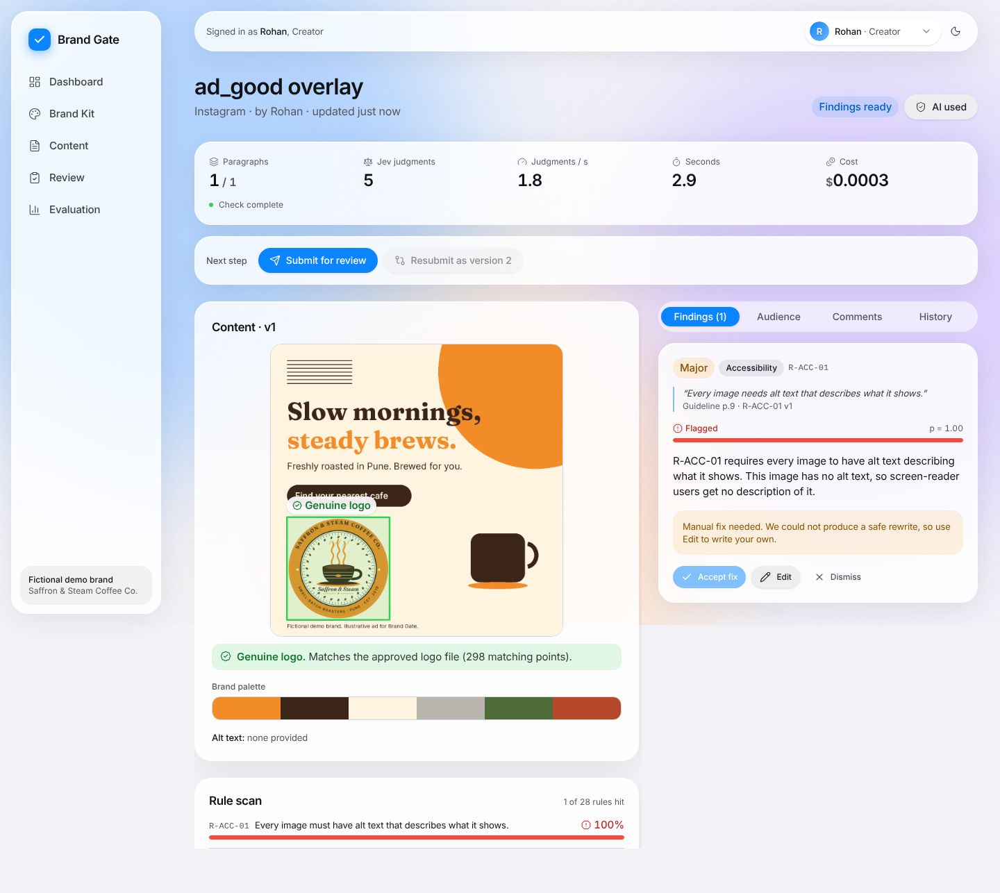
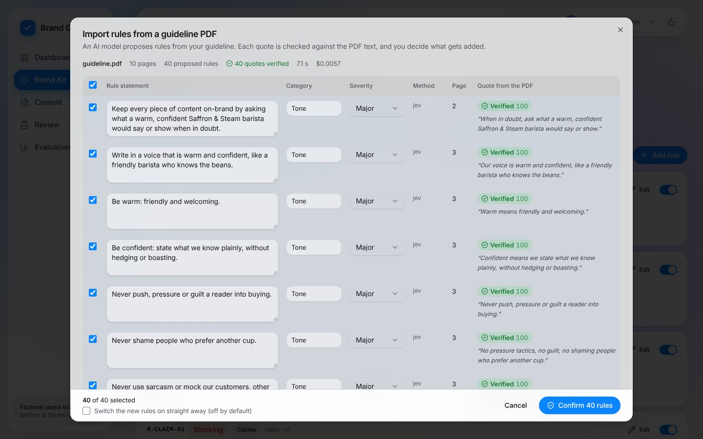
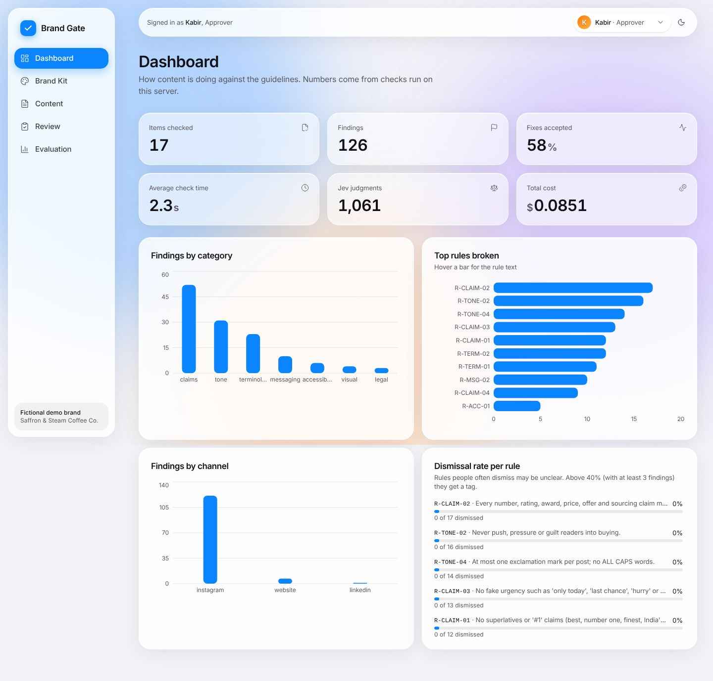
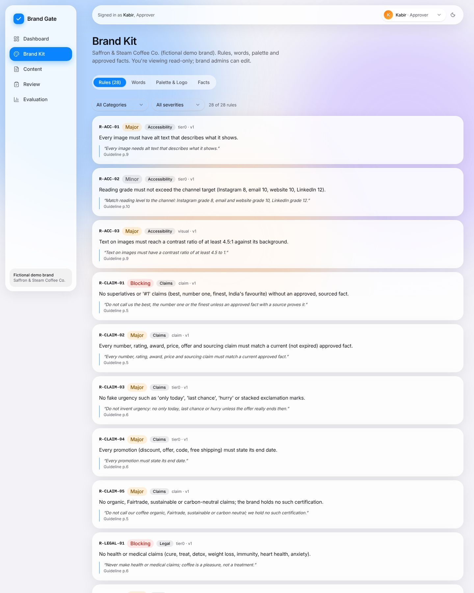

# Rulemint

Rulemint (formerly Brand Gate) checks brand content against a company's guidelines and approved facts before it is published.

A company loads its brand rules, approved facts, colour palette and logo once. Each post, image or PDF is then checked against them, and every issue cites the rule (with its quote and page) or the fact it breaks. People make every decision through a creator, reviewer and approver workflow, and no fix is applied unless a person accepts it.

Built for CodeNexus India 2026, problem statement by Inkloom AI (brand-governance platform).

Live app: https://brand-gate.onrender.com (free hosting: if it has been idle, the first page can take about a minute to wake up). The address still says brand-gate because the product was renamed to Rulemint on 8 Nov 2026; nothing else changed.

## 60-second judge walkthrough

Use a private window, so you start signed out. Every visitor gets a private workspace (its own copy of the data), so nothing you do is seen by other judges, and **Reset** only resets yours.

1. Click **Try the demo brand**. This signs you in as Rohan (Creator) of a fictional demo brand and opens a flawed Instagram caption on the New content page.
2. Click **Check**. The live meter runs, and findings stream in with their band, probability, rule ID and page.
3. Open a finding and accept its fix. The fix shows as a before and after diff, with a "verified" badge when the self-check passed.
4. Click **Resubmit as version 2**. The accepted fixes are applied and the check runs again. The version has fewer findings, and the diff shows what changed.
5. Click **Submit for review**. A blocking finding that is still open stops the submission.
6. Switch role to **Meera** (Reviewer) and add a comment on the item.
7. Switch role to **Kabir** (Approver) and click **Approve**.
8. Still as Kabir, open the seeded item he created and try to approve it. The button is disabled, and the server refuses with a message.
9. Open the **Dashboard** (counts and charts from the seeded data and your check), the **Brand Kit** (rules, words, palette and logo, facts) and the **Evaluation** page (results from the last evaluation run).

### Try it with your own brand

Click **Start fresh with your brand** on the landing page. You get an empty workspace and a five-step setup, all optional:

1. Name, tagline and a one-line description.
2. Colours (pickers or hex) and your logo (PNG or JPEG). The logo is used by the logo check.
3. Rules: import your guideline PDF (rules are proposed with the quote and page, and each quote is checked against the PDF text), add a 7-rule starter set, or write your own.
4. Approved facts: upload a CSV (`statement,value,source,valid_until`; a template is offered) or add them one by one.
5. Banned and preferred words.

Then check your first post. A brand with no rules still gets the word, fact and logo checks, and the item says "Add rules first".



## More it can do

- **Take the 2-minute tour.** On the landing page, "Take the 2-minute tour" opens a fresh demo and walks through nine steps: check a flawed post, read a finding, accept fixes and resubmit, Audience Preview on v1 and v2, Logo Fidelity, guideline PDF import, and the creator → reviewer → approver workflow. Each step has "Do it for me", which uses the app's own API. A full tour costs about $0.02 in AI calls. Once an item is approved or rejected, its findings become a read-only record ("Fixed in v2", "Left open at approval").
- **Rule clarity (unclear guidelines).** Brand Kit → Rule clarity scores every rule 0–100 from three signals: vague wording (code), Jev disagreeing with itself when the rule is restated by different readers, and how often people dismiss or override it. It suggests a clearer rewrite with examples, shows the measured effect, and an admin can apply it as a new rule version. On the demo brand the five deliberately vague rules are always the five least clear. A full run costs about $0.016.
- **Claims ledger and fact impact.** The Claims page lists every claim in your content and the approved fact behind it: supported, unsupported, contradicted or outdated, with expiry countdowns. When a fact expires or changes, its impact view lists every affected item, including approved ones, and a Brand Admin can send them back for review with a re-check. Try it: Brand Kit → Facts → edit F-04 → Mark as expired.
- **India regulatory pack.** Brand Kit → Rule packs adds 9 rules cited to their source clause (CCPA Dark Patterns Guidelines 2023, CCPA Misleading Ads Guidelines 2022, ASCI Code and Influencer Guidelines). Findings show a Regulation chip with the clause and a link to the official text. Where your own rule already flags the same words, the regulation is shown on that finding instead of flagging twice.
- **AI-image provenance.** Uploaded images are read for Content Credentials (C2PA), IPTC/XMP "digital source type", EXIF and AI-generator PNG chunks before the stored copy is stripped of metadata. An AI-made image without an "AI-generated" label in its caption or alt text gets a finding with a one-click fix. It runs locally, also for confidential items. Signatures are not verified, and a missing record proves nothing: we never claim to detect AI images without metadata.
- **Check a live web page.** New content → Web page: paste a URL. The server fetches it safely (public addresses only, size and time limits, robots.txt respected, no browser), checks the main text and up to 4 images against your brand, and adds code-based accessibility findings (alt text, link and button names, heading order, page language, link text, paragraph length).
- **Brand Score and channel limits.** Each version gets a 0–100 score worked out in code from its open findings (blocking 25/12, major 10/5, minor 3/1 for flagged / needs-a-human-look; the formula is one click away), shown on the item, the version switcher (v1 → v2), the content list and the Dashboard. Each channel has a target (default 70, editable in Brand Kit → Channels); submitting below it asks for a reason that reviewers see, and never blocks on its own. Platform limits come only from official pages, each cited: Instagram caption 2,200 characters, 30 hashtags, 20 @ tags, aspect ratio 4:5 to 1.91:1 (Meta for Developers); LinkedIn post 3,000 characters (Microsoft Learn); email subject 60 characters (vendor guidance, editable). PDFs also get a font check against the brand fonts.
- **Precedent memory.** When someone dismisses a finding with a reason or overrides a blocking one, Rulemint remembers it. Next time the same rule fires on the same wording, the card says "Seen before: dismissed by Meera on 7 Nov — reason" and the finding drops one band; a blocking rule never drops below "Needs a human look". Nothing is dismissed automatically, and admins can revoke a precedent in Brand Kit → Precedents. Try it: post "Free shipping on online orders above Rs 599. Order today." in the demo brand.
- **Hindi, Marathi and Hinglish.** Word lists, urgency and superlative triggers, sentence splitting on "।", Indian digits and lakh/crore in claims, Indian PII masking (phone numbers, UPI, PAN, Aadhaar-like numbers), and fixes that stay in the post's language. On a 23-post Indian-language set, 18 of 18 labelled issues are found (11 before), with fewer false findings; English results are unchanged.

## What it checks

| Check | How it runs | Examples |
|---|---|---|
| Rule-based code (Tier 0) | Code only, no AI | Banned words, old product names, capitalisation, readability against the channel target, claim trigger words such as "best", "#1", "guaranteed" and numbers |
| Jev judgment | Jev answers yes/no and multiple-choice questions with probabilities | Pushy or sarcastic tone, more than one call to action, a comparative claim, a line that breaks a written rule |
| Claims against approved facts | Keyword matching picks candidate facts, then Jev checks whether a fact supports the claim | "Won an award" with no matching approved fact; a claim that relies on an expired offer (marked outdated) |
| Image palette and logo | Palette colours are compared in code (CIEDE2000 distance). Logo presence, clear space and text contrast are judged by Jev | An off-palette colour in an ad; a logo placed over a busy background |
| Accessibility | Readability in code; words in an image that blend into the background, judged by Jev | Light grey text on a cream banner |

The seeded demo post ("Monsoon caption") contains deliberate problems, including a "#1" claim, a banned word, a superlative and urgency language. Urgency words such as "only today" are flagged by code even when the offer really ends that day. Each finding is banded as flag, human look or pass. Pass findings are counted in the live meter but not listed.

## How it works

Jev answers typed yes/no and multiple-choice questions with probabilities. Code makes the decisions. An LLM only writes explanations and fixes.



The FastAPI service serves the built React app and the API from one container, on one URL. A check runs in the background and streams progress to the browser over server-sent events. Each unit (a paragraph, a PDF paragraph or an image) is sent to Jev in one call with many questions. Each fix is re-checked against the same rules before it is shown. Results and the audit trail are stored in SQLite.

## Screenshots















## Run it yourself

### Docker

```bash
cp .env.example .env          # then fill in the keys you have
docker build -t brand-gate .
docker run -p 7860:7860 --env-file .env brand-gate
```

Open http://localhost:7860.

### Local development

The backend reads `.env` from the repo root, so create it there first.

```bash
cp .env.example .env

# terminal 1: backend
cd backend
pip install -r requirements.txt
uvicorn app.main:app --reload --port 7860

# terminal 2: frontend (proxies /api to port 7860)
cd frontend
npm install
npm run dev
```

Open http://localhost:5173. Run the unit tests from `backend/` with `pytest -q`. They mock Jev and the LLM.

### Environment variables

Names only, from `.env.example`. Set them in `.env` locally, or as secret environment variables on your host (the live app runs on Render).

- `TYPESAFE_API_KEY`: Jev key. The SDK reads it automatically.
- `TYPESAFE_DEFAULT_MODEL`: Jev model name.
- `LLM_BASE_URL`, `LLM_API_KEY`, `LLM_MODEL`: any OpenAI-compatible chat API, used for explanations and fixes.
- `JEV_USD_PER_M_INPUT`: Jev price used by the cost meter.
- `DEMO_MODE`: turns on the role picker, the seeded brand and the reset endpoint.
- `SESSION_SECRET`: a long random string. The development default is not safe.
- `DB_PATH`, `UPLOAD_DIR`: where the SQLite file and uploads are stored.
- `SEED_DIR`, `FRONTEND_DIST`: optional overrides.
- `WORKSPACES_DIR`, `MAX_WORKSPACES` (200), `MAX_WORKSPACES_HARD` (300), `WORKSPACE_TTL_H` (12): where per-visitor workspaces live, how many are kept, and how long an idle one lasts.
- `MAX_CONCURRENT_CHECKS`, `JEV_CONCURRENCY`, `IMAGE_MAX_SIDE`, `SIFT_MAX_SIDE`, `PRERUN_DELAY_S`: memory and speed limits for a small server.

Without `TYPESAFE_API_KEY`, the app still runs. Tier 0 and the local image checks work, and the UI shows a "Jev not configured" notice. Without the LLM key, findings still appear, with template explanations and no rewritten fixes.

## Evaluation

The dataset is `backend/app/eval/dataset.jsonl`. It has labelled items split into dev and test. Thresholds are tuned on the dev split only.

To reproduce the held-out run, from `backend/`:

```bash
python -m app.eval.run --split test
```

The run calls Jev, so set `TYPESAFE_API_KEY` first. It writes `backend/app/eval/results/latest.json`. The numbers are shown in the app's Evaluation page and come from `backend/app/eval/results/latest.json`. The page also shows the run date, the models used and a table of the misses.

## Tech stack

- **Backend:** Python 3.12, FastAPI, SQLModel on SQLite, sse-starlette for live progress, uvicorn.
- **Judgment model:** Jev through `typesafe-sdk`.
- **Writing model:** any OpenAI-compatible chat API, through the `openai` Python client. Used only for explanations, fixes and rule extraction.
- **Files and checks:** pdfplumber (PDF text with page numbers), Pillow and numpy (colours), OpenCV headless, textstat with pyphen (readability), rapidfuzz (quote and fact matching).
- **Frontend:** React 18, Vite, TypeScript, Tailwind CSS, shadcn/ui, Magic UI, framer-motion, recharts, lucide-react, Inter.
- **Deployment:** one Docker image (Node 20 builds the frontend, Python 3.12 runs the app) on port 7860. The live app runs on Render's free tier (512 MiB), with one uvicorn worker.

## Privacy and responsible AI

- **Confidential mode.** An item marked confidential runs only the local checks (Tier 0 and the local image checks). No Jev, LLM or audience calls are made. Its AI panel says "No external services used".
- **PII masking.** For other items, emails, phone numbers and long digit strings are masked before any external call. The AI panel shows how many were masked.
- **"AI used" panel.** Each item has a panel that lists every external call, grouped by provider, with its purpose, count, tokens and cost.
- **Humans approve everything.** An item moves only through the creator, reviewer and approver steps. Creators cannot approve their own items. An open blocking finding stops submission.
- **No automatic fixes.** A fix changes the text only when a person accepts it. If a fix fails the self-check, the item shows "manual fix needed".
- **Keys stay on the server.** The browser never calls Jev or the LLM directly.
- **Content is data.** The LLM prompt treats the content as data, not instructions. Model output cannot change rules or workflow state.

## Limitations

- **Workspaces are temporary.** Each visitor's workspace is a SQLite file on the server. It is deleted after 12 idle hours, and the free host wipes all of them when it restarts or sleeps after 15 idle minutes. The demo brand is rebuilt automatically. Just viewing the landing page creates nothing; a workspace is created when you pick a role, try the demo or start fresh, and one used in the last hour is never deleted to make room. If yours expired, you get a fresh demo and a notice.
- **Demo sign-in only.** There are no real accounts. Sign-in uses demo users per workspace, and the tokens are kept in the browser's session storage and a cookie.
- **Upload limits.** Images: PNG, JPG or WEBP up to 10 MB and 40 megapixels (24 MP for PNG and WEBP). Every image is stored once at up to 2048 px on the long side, which keeps a check under about 300 MiB on the 512 MiB free server. PDFs: up to 20 pages.
- **Cold start.** After a deploy or 15 idle minutes, the free server takes a moment to start. The page shows "Starting the server…" and opens by itself.
- **Reset waits for running work.** While a check, Audience Preview or PDF import is running, Reset asks you to wait.
- **Web pages are fetched without a browser.** Pages that build their text with JavaScript come back empty; accessibility checks are code-based, not a full WCAG audit. On web pages the logo check reports only the genuine logo, a stretched one or a close look-alike.
- **Rule clarity is a guide.** Jev's self-disagreement is a weak signal on its own, so vague wording does most of the separating, and a suggested rewrite doesn't always lower disagreement (the app shows when it gets worse).
- **The regulatory pack is not legal advice.** It paraphrases public guidelines and quotes short phrases with links; some patterns (bait and switch, basket sneaking) happen at checkout and can't be judged from content.
- **Scanned PDFs are not read.** A PDF with no text layer gets a "No text found" message.
- **Image judging is early.** Jev's image support is early-stage. If an image call fails, the image gets code-only checks and the finding says so.
- **Logo authenticity is not checked by Jev.** Jev has no copy of the official logo, so a redrawn logo is not caught by the Jev checks.
- **Evaluation labels are drafts.** All 60 evaluation items were labelled as drafts with AI help and are being reviewed by the team, and recall on the test split rests on 13 positive labels. Treat the Evaluation numbers as provisional.
- **Keyword triggers are blunt.** Code flags urgency and claim words even when the wording is correct in context.

## Team

- Jiteesh Ghodke (AI/ML)
- Prasoon Bodke (Backend)
- Advait Malwade (Frontend)
- Samiksha Bhusare (Product/Research, Presentation)

## Disclosure

Built by the team with AI coding assistants. The team designed the product, directed and reviewed the build, and tested it.

## Licence

Apache-2.0. Third-party licences: see NOTICE.md.
