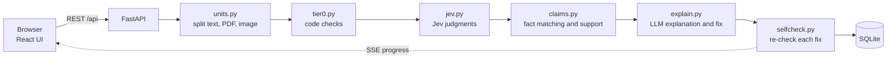

# Brand Gate

Brand Gate checks brand content against a company's guidelines and approved facts before it is published.

A company loads its brand rules, approved facts, colour palette and logo once. Each post, image or PDF is then checked against them, and every issue cites the rule (with its quote and page) or the fact it breaks. People make every decision through a creator, reviewer and approver workflow, and no fix is applied unless a person accepts it.

Built for CodeNexus India 2026, problem statement by Inkloom AI (brand-governance platform).

Live app: <link added at deployment>

## 60-second judge walkthrough

Use a private window, so you start signed out.

1. Click **Try the demo**. This signs you in as Rohan (Creator) and opens a flawed Instagram caption on the New content page.
2. Click **Check**. The live meter runs, and findings stream in with their band, probability, rule ID and page.
3. Open a finding and accept its fix. The fix shows as a before and after diff, with a "verified" badge when the self-check passed.
4. Click **Resubmit as version 2**. The accepted fixes are applied and the check runs again. The version has fewer findings, and the diff shows what changed.
5. Click **Submit for review**. A blocking finding that is still open stops the submission.
6. Switch role to **Meera** (Reviewer) and add a comment on the item.
7. Switch role to **Kabir** (Approver) and click **Approve**.
8. Still as Kabir, open the seeded item he created and try to approve it. The button is disabled, and the server refuses with a message.
9. Open the **Dashboard** (counts and charts from the seeded data and your check), the **Brand Kit** (rules, words, palette and logo, facts) and the **Evaluation** page (results from the last evaluation run).

## What it checks

| Check | How it runs | Examples |
|---|---|---|
| Rule-based code (Tier 0) | Code only, no AI | Banned words, old product names, capitalisation, readability against the channel target, claim trigger words such as "best", "#1", "guaranteed" and numbers |
| Jev judgment | Jev answers yes/no and multiple-choice questions with probabilities | Pushy or sarcastic tone, more than one call to action, a comparative claim, a line that breaks a written rule |
| Claims against approved facts | Keyword matching picks candidate facts, then Jev checks whether a fact supports the claim | "Won an award" with no matching approved fact; a claim that relies on an expired offer (marked outdated) |
| Image palette and logo | Palette colours are compared in code (CIEDE2000 distance). Logo presence, clear space and text contrast are judged by Jev | An off-palette colour in an ad; a logo placed over a busy background |
| Accessibility | Readability in code; words in an image that blend into the background, judged by Jev | Light grey text on a cream banner |

The seeded demo post ("Monsoon caption") contains deliberate problems, including a "#1" claim, a banned word, a superlative and urgency language. Urgency words such as "only today" are flagged by code even when the offer really ends that day. Each finding is banded as flag, human look or pass. Pass findings are counted in the live meter but not listed.

## How it works

Jev answers typed yes/no and multiple-choice questions with probabilities. Code makes the decisions. An LLM only writes explanations and fixes.



The FastAPI service serves the built React app and the API from one container, on one URL. A check runs in the background and streams progress to the browser over server-sent events. Each unit (a paragraph, a PDF paragraph or an image) is sent to Jev in one call with many questions. Each fix is re-checked against the same rules before it is shown. Results and the audit trail are stored in SQLite.

## Screenshots


## Run it yourself

### Docker

```bash
cp .env.example .env          # then fill in the keys you have
docker build -t brand-gate .
docker run -p 7860:7860 --env-file .env brand-gate
```

Open http://localhost:7860.

### Local development

The backend reads `.env` from the repo root, so create it there first.

```bash
cp .env.example .env

# terminal 1: backend
cd backend
pip install -r requirements.txt
uvicorn app.main:app --reload --port 7860

# terminal 2: frontend (proxies /api to port 7860)
cd frontend
npm install
npm run dev
```

Open http://localhost:5173. Run the unit tests from `backend/` with `pytest -q`. They mock Jev and the LLM.

### Environment variables

Names only, from `.env.example`. Set them in `.env` locally, or as secrets on a Hugging Face Space.

- `TYPESAFE_API_KEY`: Jev key. The SDK reads it automatically.
- `TYPESAFE_DEFAULT_MODEL`: Jev model name.
- `LLM_BASE_URL`, `LLM_API_KEY`, `LLM_MODEL`: any OpenAI-compatible chat API, used for explanations and fixes.
- `JEV_USD_PER_M_INPUT`: Jev price used by the cost meter.
- `DEMO_MODE`: turns on the role picker, the seeded brand and the reset endpoint.
- `SESSION_SECRET`: a long random string. The development default is not safe.
- `DB_PATH`, `UPLOAD_DIR`: where the SQLite file and uploads are stored.
- `SEED_DIR`, `FRONTEND_DIST`: optional overrides.

Without `TYPESAFE_API_KEY`, the app still runs. Tier 0 and the local image checks work, and the UI shows a "Jev not configured" notice. Without the LLM key, findings still appear, with template explanations and no rewritten fixes.

## Evaluation

The dataset is `backend/app/eval/dataset.jsonl`. It has labelled items split into dev and test. Thresholds are tuned on the dev split only.

To reproduce the held-out run, from `backend/`:

```bash
python -m app.eval.run --split test
```

The run calls Jev, so set `TYPESAFE_API_KEY` first. It writes `backend/app/eval/results/latest.json`. The numbers are shown in the app's Evaluation page and come from `backend/app/eval/results/latest.json`. The page also shows the run date, the models used and a table of the misses.

## Tech stack

- **Backend:** Python 3.12, FastAPI, SQLModel on SQLite, sse-starlette for live progress, uvicorn.
- **Judgment model:** Jev through `typesafe-sdk`.
- **Writing model:** any OpenAI-compatible chat API, through the `openai` Python client. Used only for explanations, fixes and rule extraction.
- **Files and checks:** pdfplumber (PDF text with page numbers), Pillow and numpy (colours), OpenCV headless, textstat with pyphen (readability), rapidfuzz (quote and fact matching).
- **Frontend:** React 18, Vite, TypeScript, Tailwind CSS, shadcn/ui, Magic UI, framer-motion, recharts, lucide-react, Inter.
- **Deployment:** one Docker image (Node 20 builds the frontend, Python 3.12 runs the app) on port 7860. Hugging Face Spaces (Docker SDK).

## Privacy and responsible AI

- **Confidential mode.** An item marked confidential runs only the local checks (Tier 0 and the local image checks). No Jev, LLM or audience calls are made. Its AI panel says "No external services used".
- **PII masking.** For other items, emails, phone numbers and long digit strings are masked before any external call. The AI panel shows how many were masked.
- **"AI used" panel.** Each item has a panel that lists every external call, grouped by provider, with its purpose, count, tokens and cost.
- **Humans approve everything.** An item moves only through the creator, reviewer and approver steps. Creators cannot approve their own items. An open blocking finding stops submission.
- **No automatic fixes.** A fix changes the text only when a person accepts it. If a fix fails the self-check, the item shows "manual fix needed".
- **Keys stay on the server.** The browser never calls Jev or the LLM directly.
- **Content is data.** The LLM prompt treats the content as data, not instructions. Model output cannot change rules or workflow state.

## Limitations

- **Demo data resets.** Data lives in a SQLite file on the server. A restart or a reset loads the seeded demo data again. On a Hugging Face Space, a restart wipes everything.
- **Demo sign-in only.** There are no real accounts. Sign-in uses demo users, and the session token is kept in the browser's session storage.
- **Scanned PDFs are not read.** A PDF with no text layer gets a "No text found" message.
- **Image judging is early.** Jev's image support is early-stage. If an image call fails, the image gets code-only checks and the finding says so.
- **Logo authenticity is not checked by Jev.** Jev has no copy of the official logo, so a redrawn logo is not caught by the Jev checks.
- **Evaluation labels are being re-labelled.** A team member is re-labelling the evaluation items. Until that finishes, treat the Evaluation numbers as provisional.
- **Keyword triggers are blunt.** Code flags urgency and claim words even when the wording is correct in context.

## Team

- Jiteesh Ghodke (AI/ML)
- Prasoon Bodke (Backend)
- Advait Malwade (Frontend)
- Samiksha Bhusare (Product/Research, Presentation)

## Disclosure

Built by the team with AI coding assistants. The team designed the product, directed and reviewed the build, and tested it.

## Licence

Apache-2.0. Third-party licences: see NOTICE.md.
